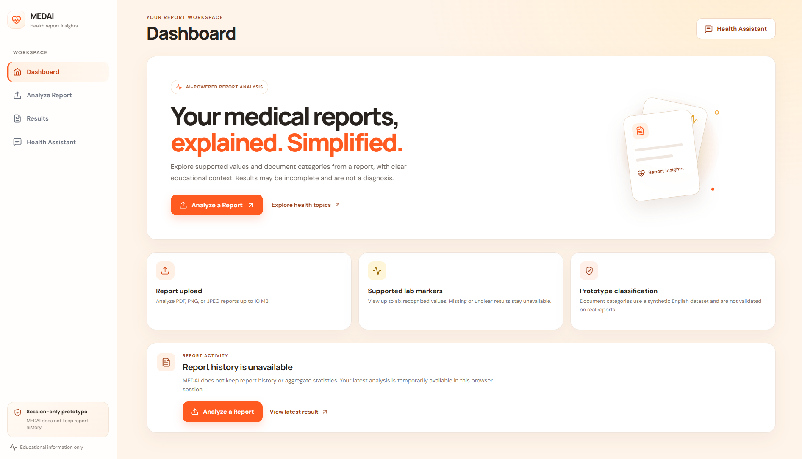
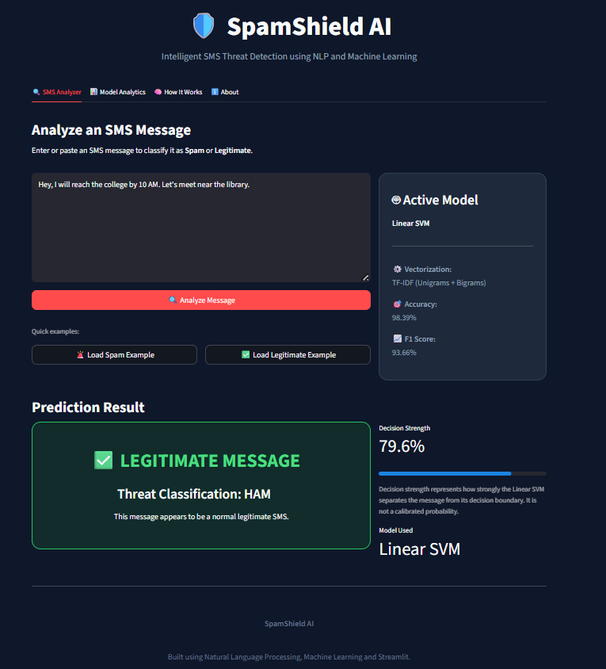
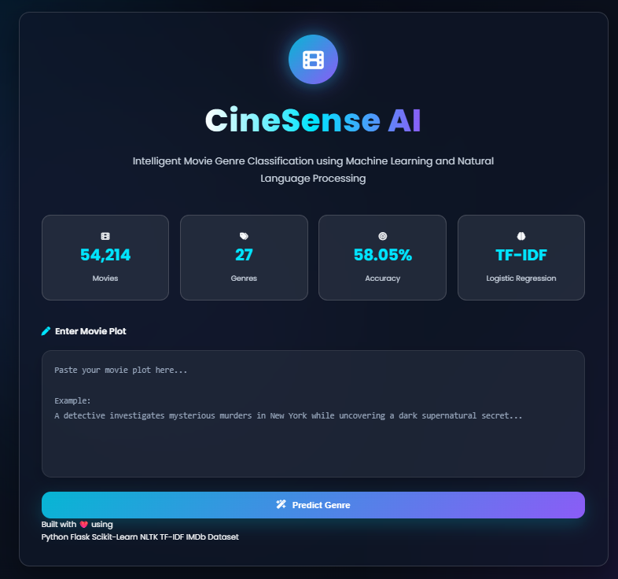

**Building intelligent applications, solving problems, and turning ideas into reality.**

[🌅 **VISIT MY LIVE PORTFOLIO →**](https://udaysthapak555.github.io/portfolio/)

[💻 GitHub](https://github.com/UdaySthapak555) · [🔗 LinkedIn](https://linkedin.com/in/udaysthapak) · [✉️ Email](mailto:uday555sthapak@gmail.com)

---

## ◈ FEATURED PROJECTS

### 🏥 MEDAI — AI Medical Report Assistant

**Python · FastAPI · React · Machine Learning**

An AI-focused application designed to classify medical reports, extract laboratory values, and present information in understandable language. It provides informational support, not medical diagnosis.

[↗ **Explore MEDAI on GitHub**](https://github.com/UdaySthapak555/MEDAI)

---

### 🛡️ SpamShield AI — Spam SMS Detection

**Python · NLP · Machine Learning**

A text-classification project focused on identifying spam messages using machine learning techniques.

[↗ **Explore SpamShield AI on GitHub**](https://github.com/UdaySthapak555/spam-sms-detection)

---

### 🎬 CineSense AI

**Python · Machine Learning · NLP**

A movie-related machine learning project exploring genre classification and text-based insights.

[↗ **Explore CineSense AI on GitHub**](https://github.com/UdaySthapak555/CineSense-AI)

---

### 💳 Credit Card Fraud Detection

**Python · Data Science · Machine Learning**

A machine learning project focused on detecting potentially fraudulent credit card transactions.

[↗ **Explore Repository**](https://github.com/UdaySthapak555/credit-card-fraud-detection-ml)

---

### 🎙️ InterviewAI — AI Mock Interview Platform

**Python · Streamlit · Gemini API**

An in-progress project exploring personalized interview questions, answer evaluation, and feedback based on a user's resume.

---

## ◈ ABOUT ME

- 🎓 BCA student specializing in Artificial Intelligence and Machine Learning.
- 🤖 Interested in Machine Learning, NLP, and Generative AI.
- 🌐 Building web applications using React, FastAPI, and Streamlit.
- 🧠 Exploring practical AI solutions for real-world problems.
- ⚡ Always learning, experimenting, and building new projects.

---

## ◈ TECH STACK

### Languages

### AI / Machine Learning

### Web Development & Tools

---

## ◈ GITHUB ACTIVITY

 

 

---

## ◈ LET'S CONNECT

### Have an idea? Let's build something meaningful.

Open to connecting with developers, learning from others, and exploring interesting projects.

[🚀 **EXPLORE MY PORTFOLIO**](https://udaysthapak555.github.io/portfolio/)

 

*“Stay curious. Keep building. Make intelligence useful.”*

